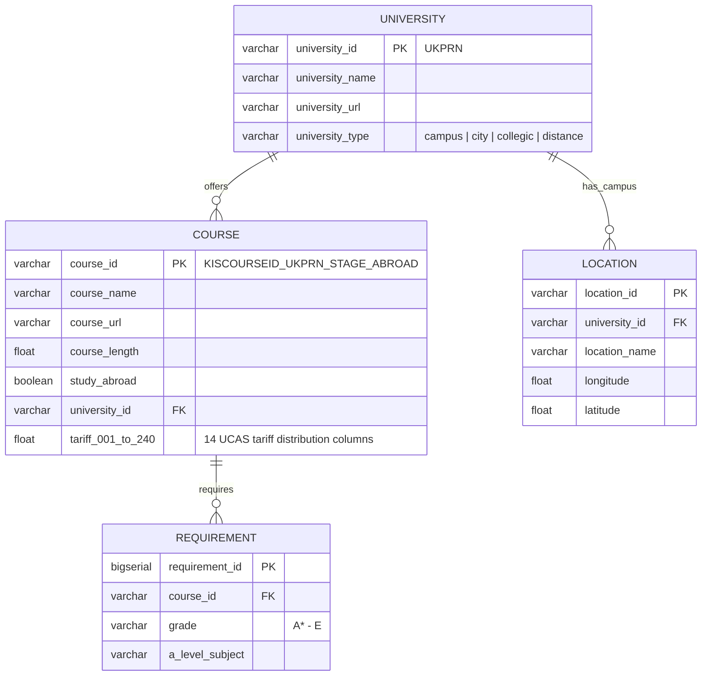

# University Course Search & Recommendation Tool


A full-stack university course recommendation web application built from scratch for my A-Level Computer Science Non-Exam Assessment (NEA) at **Exeter Mathematics School** (Sep 2024 – May 2025).

The system ingests official UK higher education (Discover Uni / KIS) and UCAS tariff datasets, matches degree programmes using natural language processing, and ranks courses in real time against a student's predicted A-Level grades, subject requirements, location, and personal preferences.

---

## Key Technical Features

### 1. Multi-Factor Weighted Scoring Engine
Each candidate course is evaluated across six distinct dimensions and combined via a user-configurable weighted average:

$$S = 100 \times \frac{\sum_{i} w_i \, s_i}{\sum_{i} w_i}$$

- **UCAS Tariff Distribution Matching ($s_{\text{tariff}}$):** Converts a student's predicted A-Level grades ($\text{A}^* = 56, \text{A} = 48, \dots, \text{E} = 16$) into a cumulative UCAS tariff score and interpolates historical entrant probability distributions across 14 UCAS tariff bands (`T001` to `T240`).
- **Geodesic Distance Calculation ($s_{\text{distance}}$):** Geocodes the user's UK postcode via OpenStreetMap `Nominatim` and computes exact ellipsoidal surface distances (in km) to university campuses using `geopy.distance.geodesic`.
- **NLP Course Title Relevance ($s_{\text{similarity}}$):** Uses `scikit-learn`'s `TfidfVectorizer` to vectorize all course titles alongside the search query, filtering and scoring candidates by **Cosine Similarity** ($\cos \theta > 0.38$).
- **Institution & Course Attributes ($s_{\text{type}}, s_{\text{abroad}}, s_{\text{length}}$):** Scores university setting (`campus`, `city`, `collegic`, `distance`), study-abroad availability, and course duration (in years) against user-defined weight sliders ($w_i \in [0, 100]$).
- **Automated Subject & Grade Requirement Warnings:** Cross-references user subjects and grades against course-specific prerequisites in the `requirement` table to flag missing subjects or grade shortfalls.

### 2. Custom $O(n \log n)$ Merge Sort & Course Grouping
- **Institution Grouping ("Course Tucking"):** Since universities often list multiple variants of the same degree (e.g., BSc vs. MPhys, with/without a year abroad), the backend groups matching courses by `university_id`, promotes the highest-scoring variant as the primary result, and nests alternative variants underneath it.
- **Recursive Merge Sort:** Ranks the aggregated university course objects in $O(n \log n)$ time complexity using a custom recursive Merge Sort implementation on encapsulated `Course` scores.

### 3. Automated Pandas ETL Pipeline & Relational Database
- **Data Cleaning & Normalization (`Database Populator.py`):** Automates the ingestion, deduplication, composite key generation, and merging of raw Discover Uni CSV tables (`INSTITUTION.csv`, `KISCOURSE.csv`, `TARIFF.csv`, `LOCATION.csv`) using `pandas`.
- **Relational Schema:** Populates four normalized tables (`university`, `course`, `location`, `requirement`) with foreign-key constraints. Developed initially as an SQLite prototype (`FLASK-API/`) before migrating to PostgreSQL (`psycopg2`) for full dataset scale.

### 4. Dynamic JavaScript UI
- Built with vanilla JavaScript (`ES6+`), HTML5, and CSS3 without frontend framework overhead.
- Features real-time slider weight updates, client-side validation (including UK postcode regular expression matching and subject-grade pairing checks), collapsible course variants, and persistent state via the browser `localStorage` API for both search parameters and favourited courses.

---

## System Architecture & Database Schema



---

## Project Structure

```text
├── UniAPI.py                  # Main Flask & Flask-RESTful application, OOP models, scoring engine & Merge Sort
├── Database Populator.py      # Pandas ETL pipeline & PostgreSQL schema creation/population script
├── requirements.txt           # Python package dependencies
├── templates/
│   ├── index.html             # Home page displaying saved favourite courses
│   └── search.html            # Interactive search form with dynamic weight sliders & grade selectors
└── static/
    ├── index.js               # Frontend logic, API fetch handling, input validation & localStorage state
    ├── index.css              # Responsive layout & component styling
    └── assets/                # UI icons and loading spinner SVG/GIF assets
```

---

## Getting Started

### Prerequisites
- **Python 3.11+**
- **PostgreSQL** running locally on port `5432`
- Raw Discover Uni (KIS) dataset CSVs (`INSTITUTION.csv`, `KISCOURSE.csv`, `TARIFF.csv`, `LOCATION.csv`) placed in the `dataset/` directory

### Installation & Setup

1. **Clone the repository and create a virtual environment:**
   ```bash
   git clone https://github.com/EdJillians/NEA.git
   cd NEA
   python -m venv .venv
   # Windows (PowerShell)
   .\.venv\Scripts\Activate.ps1
   # macOS / Linux
   source .venv/bin/activate
   ```

2. **Install dependencies:**
   ```bash
   pip install -r requirements.txt
   pip install psycopg2 pandas scikit-learn geopy
   ```

3. **Configure database credentials & dataset path:**
   Update the PostgreSQL connection string (`user`, `password`, `host`, `port`) and `FOLDER_PATH` in `Database Populator.py` and `UniAPI.py` to match your local PostgreSQL setup.

4. **Run the ETL pipeline to create and populate the database:**
   ```bash
   python "Database Populator.py"
   ```

5. **Start the Flask application:**
   ```bash
   python UniAPI.py
   ```
   Open [http://127.0.0.1:5000](http://127.0.0.1:5000) in your browser.

---

## API Reference

### `POST /courses/search`
Accepts a JSON payload of student grades, location, and preference weights, returning the top 100 ranked degree programmes (with alternative courses nested per institution).

**Example Request Body:**
```json
{
  "search_term": "Physics with Astrophysics",
  "year_abroad": false,
  "year_abroad_weight": "50",
  "course_length": "4",
  "course_length_weight": "50",
  "university_type": "campus",
  "university_type_weight": "50",
  "postcode": "EX6 6JU",
  "preferred_distance": "100-200",
  "distance_weight": "50",
  "tariff_weight": "100",
  "subject": ["Mathematics", "Further Mathematics", "Physics", "Computer Science"],
  "grades": ["A*", "A", "A", "A"]
}
```

---

## Author

**Edward Jillians**  
MPhys (Hons) Physics with Astrophysics — University of Bath  
[GitHub](https://github.com/EdJillians)
